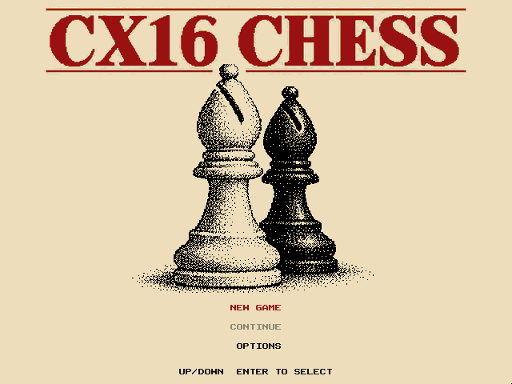
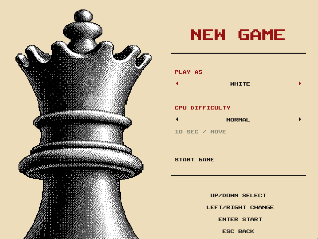
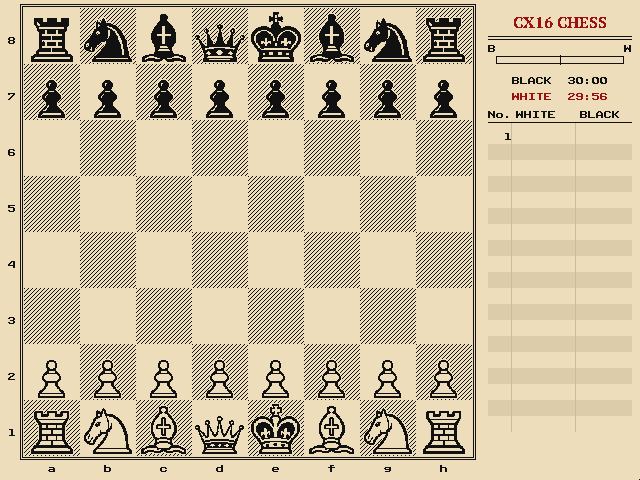

# CX16-CHESS

A chess program for the **Commander X16** with a clean newspaper layout:
640x480, sixteen colours, warm paper, bitmap lettering, serif mastheads and dark red accents.

The start screen uses a dithered bishop portrait against solid paper:



**New Game** opens a setup screen beside a queen portrait. Choose White,
Black, or Two Players and a CPU difficulty. Easy, Normal and Hard cap thinking
at 2, 10 and 20 seconds per move; remaining clock time can shorten these
budgets. Use Up/Down to select, Left/Right to change, and Return to start.
Click a setting to cycle it, or click Start Game. Escape returns to the menu.
Options configures the next game through the same setup screen.



The playing screen follows the Right Scorecard design: a large board on the
left, clocks and paired white/black moves on the right. The default board uses
fine diagonal ink hatching and the Victorian Diagram newspaper pieces, with
mitred bishops, masonry rooks, and crowned kings. **M** opens the menu
and pauses the clocks. Options previews appearance on a full-size board, with
independent board and piece-set selectors. It offers Victorian Diagram,
Continental Engraving, and Daily Letterpress pieces, plus fine hatching,
crosshatching, coarse hatching, and wood boards. Selections apply immediately
to the preview and are used when starting or resuming a game. Continue (or Escape from the main menu) resumes the
same game; it is disabled until a game has been started. Continue is for the
current session, rather than a saved game on disk.



**I** toggles the move sheet, **T** changes between solid brown squares and
a hatched printed diagram, and **F** flips the board.

## Features so far

* Full rules: castling, en passant, promotion (with a piece picker on the
  board), check, checkmate, stalemate, fifty-move rule and insufficient
  material.
* A 448x448 board (56-pixel squares), compact clocks beside WHITE / BLACK, a signed
  evaluation bar, and animated figurines while the engine thinks. The TIME
  percentage shows how much of its search budget has elapsed; a forced move
  or mate may finish early.
* Analysis remains available with **A**: the engine searches for up to
  10 seconds and updates the evaluation bar.
* A scrolling score sheet with 19 numbered white/black move pairs in figurine
  algebraic notation.
* Newspaper styling: serif headings, thin rules, warm flat paper, dithered
  chess portraits, and four board styles with three newspaper piece sets.
* Selected pieces use heavy red brackets, legal destinations use hollow
  rings, and captures use corner wedges. The brackets, rings and wedges use
  the masthead red (#991111) with paper keylines. Selection preserves the
  original board colors. The last move and check are highlighted separately.
* Mouse and keyboard control; the board can be flipped.
* A chess engine in 65C02 assembly that searches 4-6 plies within 10-30
  seconds on the 8 MHz X16 (see [The engine](#the-engine)).

## Controls

| Action | Mouse | Keyboard |
| --- | --- | --- |
| Select piece / move | Left click | Arrows + Return or Space |
| Cancel selection | Click an empty square | Escape |
| Analyse the position | | A |
| Move sheet on / off | | I or Tab |
| Flip board | | F |
| Board style | Options selectors | T |
| Computer plays black / white / nobody | | C |
| New game setup | Main menu | N |
| Menu / pause | | M |
| Appearance options | OPTIONS on opening screen | O in menu |
| Menu selection / setup field | Click a row | Up / Down |
| Change setup choice | Click the value | Left / Right |
| Start / confirm | Click Start Game | Return or Space |
| Back / continue from menu | | Escape |

## Building

Requires **cc65**, **Python 3** with **Pillow** and **NumPy**, GNU make
and a C compiler (for the native tests).

```sh
make            # build src/CHESS.PRG (the game) and src/ENGINE.PRG
make run        # build and start the emulator
make test       # native tests: rules perft and SAN, engine perft and mates
make test-ui    # emulator tests: menus, setup, clocks, moves, palette
make screenshot # headless capture via the X16 AgentBridge emulator
make test-dist  # run emulator tests using only the distribution files
make test-sd    # test the ROM SD-card loader (requires mkfs.fat and mcopy)
make dist       # package only the playable game in build/dist/CHESS.ZIP
make clean      # remove everything generated
```

The X16 engine tests need the [AgentBridge](https://github.com/ifilot/x16-emulator)
emulator in `../x16-emulator`; `make fuzz`, `make wac` and the match and
review tools also need python-chess (`pip install chess`) and, for matches
and reviews, Stockfish (`/usr/games/stockfish`):

```sh
make parity     # X16 assembly engine vs the native C reference
make fuzz       # random positions: evaluation, move generation, validation
make bench      # search depth within 5, 10 and 30 seconds
make wac        # Win At Chess test suite at 10 s per position
```

`make run` uses `../x16-emulator/build/x16emu` and the first ROM found in
`../emulator/rom.bin` or `../emulator-win/rom.bin`; override with
`make run EMU=... ROM=...`. For distribution, run `make dist` and extract `build/dist/CHESS.ZIP`.
Keep these three runtime files together: `CHESS.PRG`, `MENU.BIN` and
`CHESS.DAT`. All distribution filenames follow 8.3. The ZIP excludes the
headless engine, intermediate graphics, previews, symbols and test files.
All `.DAT` files are generated from the checked-in bitmap artwork, fonts and
Python generators; none are tracked by Git. Intermediate tiles and maps live
in `build/graphics/`; `src/` contains just one runtime graphics container.

`CHESS.DAT` contains a 16-byte build identifier, twenty index entries (32-bit
file offset and 16-bit length), and the original graphics bytes without VRAM
padding. The packer verifies every resource against its generated source.
The loader validates the identifier against the compiled index, keeps a data
channel open and seeks to each resource using CMDR-DOS POSITION. KERNAL MACPTR
streams data directly into VERA or banked RAM, handling partial reads; ACPTR
provides a fallback when bulk reads are unavailable. Read errors and premature
EOF abort loading while the display is hidden. Screen changes load only the
required resources; font, sprites and game state stay resident.

The distribution includes `HASHES.TXT` for verifying all three runtime files.
`make test-dist` exercises the menus, all piece sets and board styles, gameplay,
and indicators using the distribution directory as the emulator filesystem.
It also checks missing, mismatched and truncated containers, partial reads and
byte-at-a-time fallback. `make test-sd` creates `build/dist/CHESS.IMG`, a FAT32
SD image, and tests the actual ROM CMDR-DOS path, including all twelve board/set
combinations. It requires dosfstools and mtools; it never accesses a physical disk.
`make` also builds `src/ENGINE.PRG`, a headless engine harness for the test tools
below; its separate linker configuration cannot overwrite `MENU.BIN`.

## Source layout

The game is split into a core without any graphics and a front end:

| Directory | Contents |
| --- | --- |
| `src/core/` | `rules.c` (move rules, SAN), `match.c` (game controller: moves, clocks, results, who plays which side), the engine (`engine*.c`, `engine_asm.s`, `engine_search.s`) |
| `src/gui/` | VERA set-up (`video.c`), start/setup menus (`start.c`), the playing field (`playfield.c`, drawing and input only), `main.c` |
| `src/bridge/` | `ENGINE.PRG`: the engine driven through a mailbox at `$0400` |
| `tools/` | AgentBridge drivers: screenshots, engine bridge, tests, matches |

The front end only talks to `match.h`; it never calls the engine. The
engine only shares the 0x88 board encoding with `rules.h` and receives
positions through `engine_set_position()`.

## The engine

* 0x88 board with incrementally updated material, piece-square score,
  32-bit Zobrist hash, pawn structure and check status.
* Iterative deepening, principal variation search, transposition table
  (16384 entries in banked RAM), hash move tried before move generation,
  null move, late move reductions, futility pruning (depth 1-3), late move
  pruning, check extensions, killer and history move ordering, capture
  search with delta pruning, repetition and fifty-move detection.
* Evaluation: material and piece-square tables, king tables for the
  endgame, bishop pair, doubled / isolated / passed pawns (cached), pawn
  shelter, and mop-up of a bare king.
* The per-node code (board, move generation, evaluation, search) is 65C02
  assembly. The same algorithm exists in C (`engine_hot.c`, `search()` in
  `engine.c`) for native builds; both visit exactly the same nodes, which
  `tools/parity_test.py` checks.
* Memory: the engine's tables use RAM banks 1-18 (bank 19 holds the move
  list of the game).

Speed on the 8 MHz X16 is 400-1200 nodes per second (each node includes
move generation and evaluation). Depth reached (plies, plus captures and
check extensions):

| Position | 5 s | 10 s | 30 s |
| --- | --- | --- | --- |
| Opening / middlegame | 3-4 | 4-5 | 5-6 |
| Endgame | 4-9 | 5-11 | 7-15 |

### Testing

All engine tests run the real X16 binary in the
[AgentBridge](https://github.com/ifilot/x16-emulator) emulator, which runs
about 7 times faster than a real X16; times below are emulated X16 time.

| Tool | Purpose |
| --- | --- |
| `tools/engine_bridge.py` | drives `ENGINE.PRG` through its mailbox (used by all tools below) |
| `tools/parity_test.py` | X16 assembly engine vs native C reference: perft, evaluation, full searches |
| `tools/fuzz_test.py` | random positions: evaluation, move generation, move validation |
| `tools/depth_bench.py` | depth reached within a time limit |
| `tools/epd_test.py` | test suites, e.g. `tests/epd/wac.epd` (Win At Chess) |
| `tools/match.py --x16` | games against Stockfish with limited strength |
| `tools/review_games.py` | centipawn loss of every move, by local Stockfish or (`--online`) Lichess cloud evaluation and chess-api.com |
| `tools/selfplay.py` | native self-play between engine variants, for tuning |
| `tools/profile_engine.py` | statistical profiler: samples the emulated program counter |
| `tools/x16uci.py` | the emulated X16 engine as a UCI engine |
| `tools/screenshot.py` | boots the game, clicks and types, captures screenshots |

Results with 10 s per move (October 2026, details and games in
[docs/engine](docs/engine/RESULTS.md)):

| Test | Result |
| --- | --- |
| vs Stockfish 16, UCI_Elo 1320 (48 games) | 31/48 = 65% |
| vs Stockfish 16, UCI_Elo 1500 (48 games) | 15.5/48 = 32% |
| Estimated rating | about 1400 (Stockfish UCI_Elo scale) |
| Win At Chess (300 positions) | 187 solved |
| Average centipawn loss (Stockfish 16 review) | 45-53 |

## How it is built

* **Layer 0** shows the background: 8x8 tiles at 4 bpp, deduplicated
  (488 tiles). There are two complete tilemaps in VRAM, with and
  without the move sheet; switching the view only changes the map base.
  Board squares switch between pre-rendered 7x7-tile variants for their
  highlighted states (`SQTILES` resource, kept in banked RAM). The active clock is drawn in red ink.
* **Layer 1** shows pieces (7x7 tiles) and text with transparent index 0.
  The 16 palette rows repeat the base palette with a different ink colour,
  so text colour is just the tilemap palette offset.
* The game keeps its C stack in golden RAM ($0400-$07FF) to leave main RAM
  for code and engine tables.
* **Sprites** are used for the mouse pointer and the keyboard cursor.
* `assets/scripts/build_graphics.py` renders the whole screen from
  `assets/scripts/layout.py` and `palette.py` and writes intermediate VRAM data into `build/graphics/`.
  `tools/package_graphics.py` packs it into `src/CHESS.DAT` and generates the
  resource index and `src/gfx.h`.
* `assets/scripts/bitmap_font.py` regenerates the native ASCII font sheet
  automatically when its source changes. Active portraits, newspaper pieces,
  and serif masthead artwork are kept as approved PNG sources.
* Start/setup artwork is split between both tile layers at native 640x480;
  each layer stays within its tile and VRAM budget. Menu code lives in RAM
  bank 21 (`MENU.BIN`), leaving main RAM for the engine. Returning to
  play reloads the playing-field graphics without resetting the match.
  Startup loads only opening-screen assets; engine and board data wait until
  the first game. Screens become visible after artwork and controls are drawn.
  The bitmap font and scorecard background map stay resident, avoiding repeated
  disk transfers. Layer-1 map clears use a direct VERA write loop.
  Startup graphics loading is roughly halved; retaining the font and scorecard
  map avoids repeated transfers. The original optimization measurements are
  recorded in `docs/startup-performance.json`; HostFS timings exclude physical
  disk transfer time.
* UI text uses Kakuro’s native 8×8 bitmap glyphs, with integer pixel
  scaling for headings. Game clocks use the native font. The CX16 CHESS mastheads retain their original
  serif artwork. The board margins show only coordinates;
  evaluation appears as a bar in the scorecard. Scorecard figurines use supplied native
  pixel art in 16×16 cells, assembled from four 8×8 tiles; text retains its
  8-pixel advance. The foreground uses 833 of VERA’s 1024 tiles, including smooth bar fills.
* Blank paper uses one solid palette color. Dithering is confined to the
  portraits; the runtime labels and controls remain crisp.
* The opening screen uses the approved Black + paper only portrait,
  black dithering and solid `#EEDDBB` paper. Its shared `PALETTE` resource
  keeps the screen within 16 colors. Setup loads the `SETPAL` resource for a four-tone
  black/gray/white queen that extends through the bottom edge; play restores
  `PALETTE` resource. Red setup headings and clickable left/right triangles use
  the native bitmap font slots. Keyboard arrows still select and change values.
* Portrait tiles on layer 1 have an underlay matching palette index zero:
  black on both the opening screen and setup. Index zero is
  transparent on that layer but opaque in the source artwork.
  Palette row zero preserves all sixteen source colors. The graphics build
  decodes the exported 4bpp tiles and maps and rejects any changed pixel,
  invalid palette, missing tile, or exceeded tile budget. Its previews come
  from that verified reconstruction.
* `make test` includes transparency/palette regression tests. `make test-ui`
  checks that no board or unfinished artwork appears during startup, then
  compares the actual emulator screenshots against the verified portraits
  with zero pixel tolerance, including after menu transitions. The mouse
  pointer is moved outside the artwork before comparison.

The approved splash, Victorian board, and selector pixel references live in
`tests/fixtures/graphics/`. Tests have no dependency on historical galleries.
The design explorations, old screenshots, and obsolete assets are preserved
in an external archive listed in `docs/cleanup-manifest.json`; every archived
file was read back and SHA256 verified before removal. The compact font layout
and removed slots are documented in `assets/font/README.md`.

## Credits

* Active chess pieces: Victorian Diagram, Continental Engraving, and Daily
  Letterpress, generated with imagegen from the supplied newspaper reference.
  Cburnett’s older unused artwork is archived; attribution remains in
  `assets/pieces/README.md`.
* Fonts: native 8×8 bitmap UI font from Ivo Filot's CX16 Kakuro (GPL-3.0-or-later), see `assets/font/README.md`.
* Serif masthead lettering: PT Serif (ParaType, SIL Open Font License 1.1).
* Start/setup portraits generated with imagegen and constrained to the
  project palette; source artwork lives in `assets/art/splash.png` and
  `assets/art/setup.png`.

## License

Unless otherwise stated, the code in this repository is provided under the
GNU General Public License version 3.
