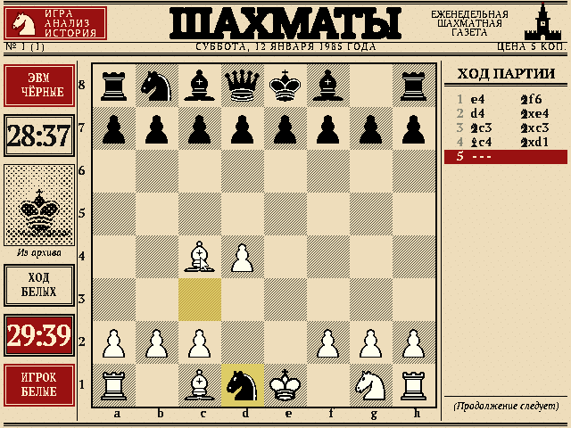
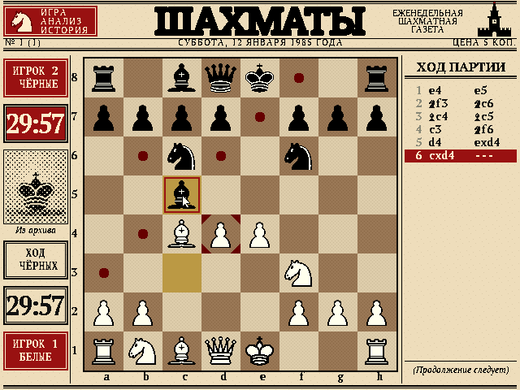

# CX16-CHESS

A chess program for the **Commander X16** laid out as the front page of a
Soviet chess gazette from the 1980s: 640x480, sixteen colours.

> Work in progress. The playing field and the chess engine are done; you
> play against the computer (or a friend). Menus and a title screen come
> later.


Playing against the computer ("ЭВМ", the Soviet word for a computer):



The board can also be shown in the wooden style (key **T**):



## Features so far

* Full rules: castling, en passant, promotion (with a piece picker on the
  board), check, checkmate, stalemate, fifty-move rule and insufficient
  material.
* Move list in figurine algebraic notation, as printed in chess columns, and
  two 30-minute clocks.
* Newspaper styling: masthead with ears and dateline, column rules, PT Serif
  typography, a halftone "photo" and a printed-diagram board with hatched
  dark squares.
* Legal destinations, captures, the last move and check are highlighted.
* Mouse and keyboard control; the board can be flipped.
* A chess engine in 65C02 assembly that searches 4-6 plies within 10-30
  seconds on the 8 MHz X16 (see [The engine](#the-engine)).

## Controls

| Action | Mouse | Keyboard |
| --- | --- | --- |
| Select piece / move | Left click | Arrows + Return or Space |
| Cancel selection | Click an empty square | Escape |
| Flip board | | F |
| Board style (diagram / wood) | | T |
| Computer plays black / white / nobody | | C |
| New game | | N |

## Building

Requires **cc65**, **Python 3** with **Pillow** and **NumPy**, GNU make
and a C compiler (for the native tests).

```sh
make            # build src/CHESS.PRG (the game) and src/ENGINE.PRG
make run        # build and start the emulator
make test       # native tests: rules perft and SAN, engine perft and mates
make screenshot # headless capture via the X16 AgentBridge emulator
make clean      # remove everything generated
```

The X16 engine tests need the [AgentBridge](https://github.com/ifilot/x16-emulator)
emulator in `../x16-emulator`; `make fuzz`, `make wac` and the match and
review tools also need python-chess (`pip install chess`) and, for matches
and reviews, Stockfish (`/usr/games/stockfish`):

```sh
make parity     # X16 assembly engine vs the native C reference
make fuzz       # random positions: evaluation, move generation, validation
make bench      # search depth within 5, 10 and 30 seconds
make wac        # Win At Chess test suite at 10 s per position
```

`make run` uses `../x16-emulator/build/x16emu` and the first ROM found in
`../emulator/rom.bin` or `../emulator-win/rom.bin`; override with
`make run EMU=... ROM=...`. Keep all files in `src/` (`CHESS.PRG` and the
`.DAT` files) together. `make` also builds `src/ENGINE.PRG`, a headless
engine harness for the test tools below.

## Source layout

The game is split into a core without any graphics and a front end:

| Directory | Contents |
| --- | --- |
| `src/core/` | `rules.c` (move rules, SAN), `match.c` (game controller: moves, clocks, results, who plays which side), the engine (`engine*.c`, `engine_asm.s`, `engine_search.s`) |
| `src/gui/` | VERA set-up (`video.c`), the playing field (`playfield.c`, drawing and input only), `main.c` |
| `src/bridge/` | `ENGINE.PRG`: the engine driven through a mailbox at `$0400` |
| `tools/` | AgentBridge drivers: screenshots, engine bridge, tests, matches |

The front end only talks to `match.h`; it never calls the engine. The
engine only shares the 0x88 board encoding with `rules.h` and receives
positions through `engine_set_position()`.

## The engine

* 0x88 board with incrementally updated material, piece-square score,
  32-bit Zobrist hash, pawn structure and check status.
* Iterative deepening, principal variation search, transposition table
  (16384 entries in banked RAM), hash move tried before move generation,
  null move, late move reductions, futility pruning (depth 1-3), late move
  pruning, check extensions, killer and history move ordering, capture
  search with delta pruning, repetition and fifty-move detection.
* Evaluation: material and piece-square tables, king tables for the
  endgame, bishop pair, doubled / isolated / passed pawns (cached), pawn
  shelter, and mop-up of a bare king.
* The per-node code (board, move generation, evaluation, search) is 65C02
  assembly. The same algorithm exists in C (`engine_hot.c`, `search()` in
  `engine.c`) for native builds; both visit exactly the same nodes, which
  `tools/parity_test.py` checks.
* Memory: the engine's tables use RAM banks 1-18 (bank 19 holds the move
  list of the game).

Speed on the 8 MHz X16 is 400-1200 nodes per second (each node includes
move generation and evaluation). Depth reached (plies, plus captures and
check extensions):

| Position | 5 s | 10 s | 30 s |
| --- | --- | --- | --- |
| Opening / middlegame | 3-4 | 4-5 | 5-6 |
| Endgame | 4-9 | 5-11 | 7-15 |

### Testing

All engine tests run the real X16 binary in the
[AgentBridge](https://github.com/ifilot/x16-emulator) emulator, which runs
about 7 times faster than a real X16; times below are emulated X16 time.

| Tool | Purpose |
| --- | --- |
| `tools/engine_bridge.py` | drives `ENGINE.PRG` through its mailbox (used by all tools below) |
| `tools/parity_test.py` | X16 assembly engine vs native C reference: perft, evaluation, full searches |
| `tools/fuzz_test.py` | random positions: evaluation, move generation, move validation |
| `tools/depth_bench.py` | depth reached within a time limit |
| `tools/epd_test.py` | test suites, e.g. `tests/epd/wac.epd` (Win At Chess) |
| `tools/match.py --x16` | games against Stockfish with limited strength |
| `tools/review_games.py` | centipawn loss of every move, by local Stockfish or (`--online`) Lichess cloud evaluation and chess-api.com |
| `tools/selfplay.py` | native self-play between engine variants, for tuning |
| `tools/profile_engine.py` | statistical profiler: samples the emulated program counter |
| `tools/x16uci.py` | the emulated X16 engine as a UCI engine |
| `tools/screenshot.py` | boots the game, clicks and types, captures screenshots |

Results with 10 s per move (October 2026, details and games in
[docs/engine](docs/engine/RESULTS.md)):

| Test | Result |
| --- | --- |
| vs Stockfish 16, UCI_Elo 1320 (48 games) | 31/48 = 65% |
| vs Stockfish 16, UCI_Elo 1500 (48 games) | 15.5/48 = 32% |
| Estimated rating | about 1400 (Stockfish UCI_Elo scale) |
| Win At Chess (300 positions) | 187 solved |
| Average centipawn loss (Stockfish 16 review) | 45-53 |

## How it is built

* **Layer 0** shows the background: 16x16 tiles at 4 bpp, deduplicated
  (about 320 tiles). It is scrolled by 8 pixels so the 48x48 squares sit on
  an 8-pixel grid. Board squares, clock boxes and move rows switch between
  pre-rendered tile variants for their highlighted states.
* **Layer 1** shows pieces (6x6 tiles of 8x8) and text with transparent
  index 0. The 16 palette rows repeat the base palette with a different ink
  colour, so text colour is just the tilemap palette offset.
* **Sprites** are used for the mouse pointer and the keyboard cursor.
* `assets/scripts/build_graphics.py` renders the whole screen from
  `assets/scripts/layout.py` and `palette.py` and writes the VRAM files and
  `src/gfx.h`.
* `assets/scripts/make_sources.py` regenerates the committed PNG sources
  (pieces, fonts, masthead, halftone photo) from the third-party originals.
  It is not part of the normal build.
* Blank paper carries a fixed speck pattern that repeats every 16 pixels, so
  the newsprint texture costs no extra tiles.

## Credits

* Chess pieces: Cburnett set by Colin M.L. Burnett (GFDL/BSD/GPL), see
  `assets/pieces/README.md`.
* Fonts: PT Serif by ParaType (SIL OFL 1.1), see `assets/font/README.md`.
* Masthead lettering rendered from Roboto Slab Bold.

## License

Unless otherwise stated, the code in this repository is provided under the
GNU General Public License version 3.
