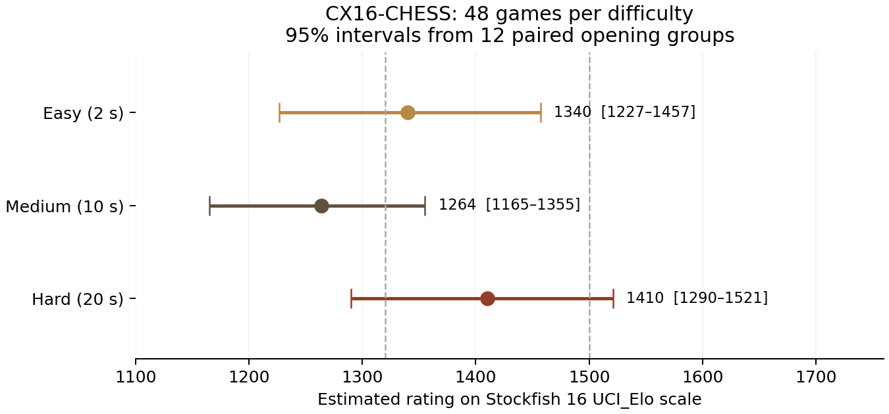

# Difficulty strength test — 2026-10-10

The real `src/ENGINE.PRG` played **144 games** against the locally installed
**Stockfish 16**: 48 games for each difficulty. Hard had the highest point
estimate. Medium (called `normal` internally) scored below Easy in this sample;
the uncertainty is too large to establish the ordering of the three levels.

| Difficulty | Search cap | Wins / draws / losses | Points | Estimated Elo | 95% interval |
| --- | --- | --- | --- | --- | --- |
| Easy | 2 s | 15 / 9 / 24 | 19.5 / 48 (40.6%) | 1340 | 1227–1457 |
| Medium (Normal) | 10 s | 13 / 4 / 31 | 15 / 48 (31.3%) | 1264 | 1165–1355 |
| Hard | 20 s | 22 / 4 / 22 | 24 / 48 (50.0%) | 1410 | 1290–1521 |

These estimates use **Stockfish's UCI_Elo scale**, not a measured FIDE rating.
Stockfish's lowest supported setting is 1320, so estimates below that value
are extrapolations from the game scores. The intervals describe sampling
uncertainty; they do not include uncertainty in Stockfish's rating calibration.



## Scores against each opponent

Each cell gives points out of 24 games, with 12 games as White and 12 as Black.

| Difficulty | Stockfish 1320 | Stockfish 1500 |
| --- | --- | --- |
| Easy | 11.5 / 24 | 8 / 24 |
| Medium | 10.5 / 24 | 4.5 / 24 |
| Hard | 13 / 24 | 11 / 24 |

Comparisons resample the same opening groups across both levels, preserving
their pairing. All three intervals include zero, so this run does not establish
a statistically clear difference between any pair.

| Comparison | Estimated Elo difference | Paired 95% interval |
| --- | --- | --- |
| Hard minus Easy | +70 | −106 to +257 |
| Hard minus Medium | +146 | −9 to +310 |
| Medium minus Easy | −76 | −246 to +59 |

The [earlier fixed-10-second test](../RESULTS.md) estimated approximately 1400.
This new Medium estimate is lower. These are different samples and clock
conditions, so their difference alone does not demonstrate an engine regression.
A larger repeated test would be needed to distinguish sampling variation from
a systematic issue with the difficulty settings.

## Method and timing

- Twelve opening lines from `tools/match.py`, each played in both colours
  against both Stockfish settings for every difficulty.
- The actual banked 65C02 engine runs headlessly in AgentBridge at **8 MHz
  emulated time**. The emulator runs faster than real time on the host; this
  accelerates the experiment without increasing the engine's emulated search
  budget. Twelve independent matches run in parallel. Each Stockfish process
  uses `Threads=1`, `Hash=16`, `UCI_LimitStrength=true`, and 0.1 host seconds
  per move.
- The X16 side starts with a virtual 1800-second clock. Its move budget follows
  the game formula `max(2, min(difficulty_cap, remaining_seconds // 30))`.
  The clock subtracts elapsed emulator cycles for the bridge request, including
  position replay and mailbox overhead. This approximates the game's clock;
  it does not reproduce all GUI costs. The headless search omits the graphical
  progress callback. Search limits are soft because time is checked periodically.
- Ratings solve the average expected Elo score against the two anchors for
  the observed total score. Intervals use 20,000 bootstrap samples of whole
  opening groups, with seed 16. Pair comparisons use identical sampled opening
  groups across levels. There are only 12 such groups, so the intervals should
  be treated as approximate.
- Every PGN was parsed and checked for legal moves, matching recorded results,
  and balanced colours/opponents. All games ended naturally: 127 checkmates,
  15 threefold repetitions, and 2 fifty-move draws. There were no time forfeits
  or move-limit adjudications.

The larger budgets did produce deeper searches:

| Difficulty | Mean depth (plies) | Mean nodes / search | Mean bridge elapsed (emulated s) |
| --- | --- | --- | --- |
| Easy | 3.33 | 1169 | 2.42 |
| Medium | 4.65 | 5356 | 9.92 |
| Hard | 5.21 | 10345 | 18.81 |

The elapsed column includes bridge overhead, rather than just search time.
Long games can reduce the budget below the difficulty cap as the clock runs down.

## Artifacts and reproduction

- Games: [Easy](easy.pgn), [Medium](normal.pgn), [Hard](hard.pgn).
- [Summary and paired comparisons](summary.json), [configuration and engine
  SHA-256](configuration.json), [per-game statistics](games.jsonl).
- Runner: [tools/rate_difficulties.py](../../../tools/rate_difficulties.py).

With Python, `python-chess`, the X16 AgentBridge emulator, and local Stockfish
installed, run from the repository root:

```sh
make -C src ENGINE.PRG
python3 tools/rate_difficulties.py --workers 12 --stockfish /usr/games/stockfish \
  --date 2026-10-10 --out docs/engine/difficulty-2026-10-10
```

The runner checkpoints every game and resumes matching configurations. Use a
new output directory for a fresh experiment or a different engine binary.
